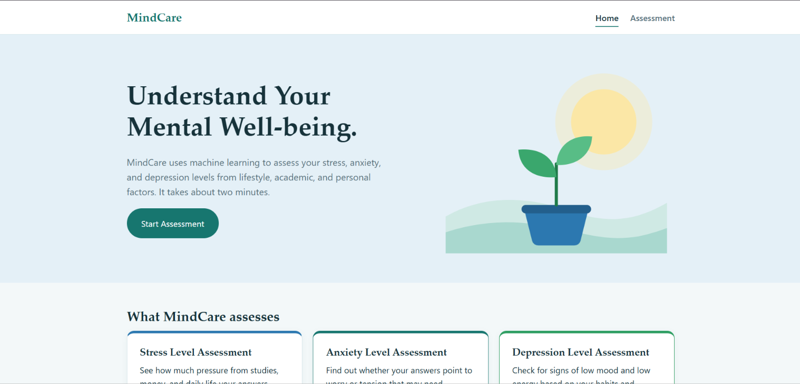
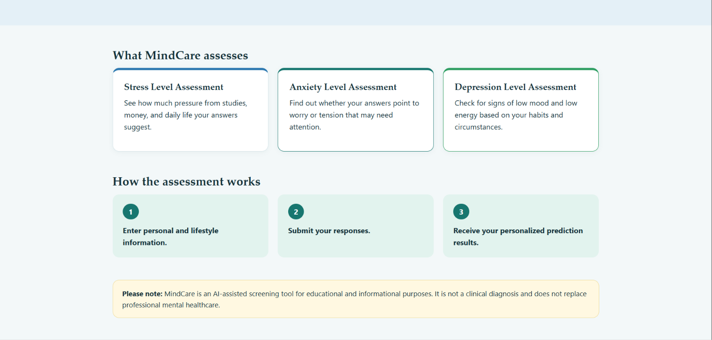
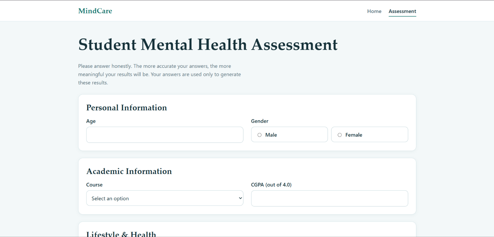
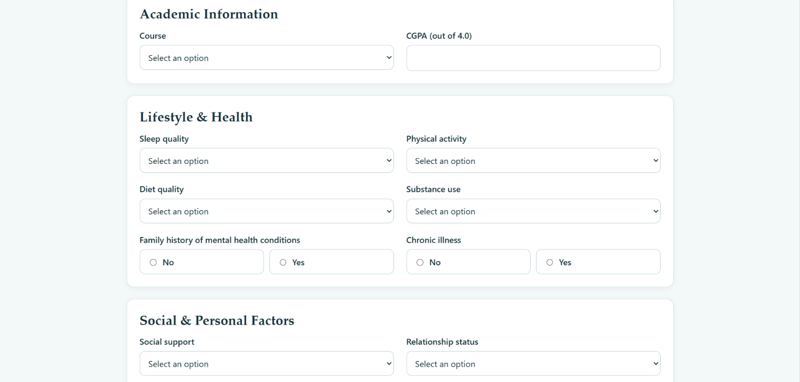
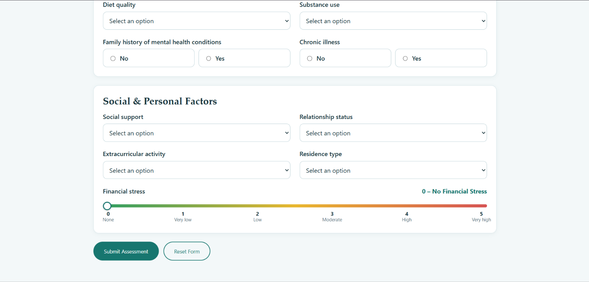
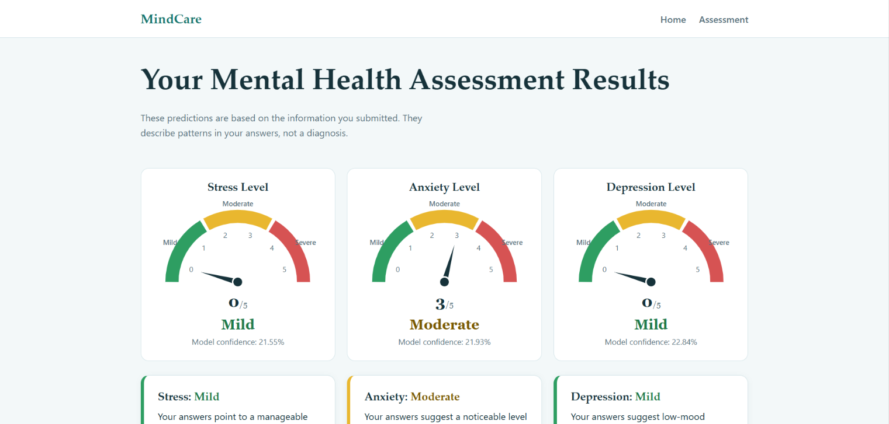
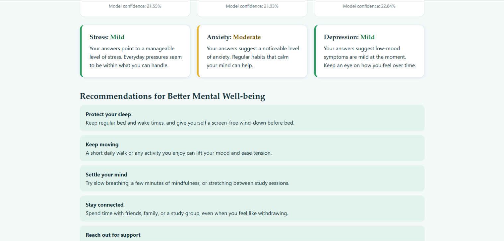
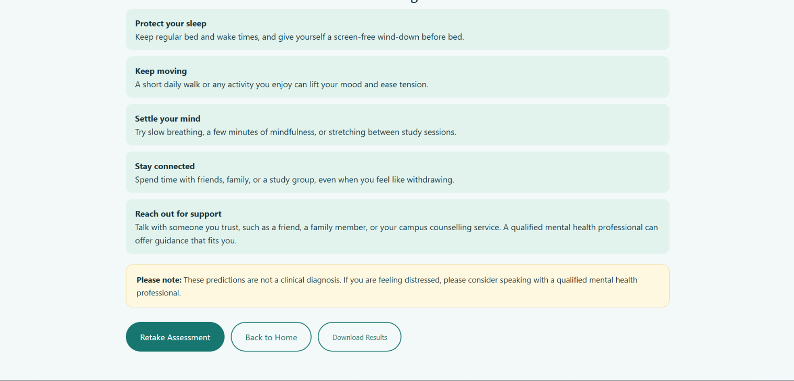

# MindCare: Student Mental Health Assessment

A three-page web app that takes 15 lifestyle, academic and personal inputs from a student and predicts **Stress**, **Anxiety** and **Depression** severity with machine learning models. The results are shown on semicircular needle gauges.

> **Educational prototype, not a diagnostic tool.** The models perform no better than guessing the most common class. Do not use the output to make decisions about anyone's health. If you are struggling, please talk to a qualified mental health professional.

**Live demo:** https://mindcare-qj7t.onrender.com

## Screenshots

### Home Page



### Assisment Page




### Result Page





## Features

- **Three pages:** Home, Assessment, Results
- **Input validation** in the browser and again on the server
- **Gauges** with the needle pinned to the predicted 0 to 5 score
- **Severity bands:** 0 to 1 Mild, 2 to 3 Moderate, 4 to 5 Severe
- **Recommendations** that change with the predicted severity
- **Download Results** as a text summary

## Inputs and outputs

**15 input features** (names and values must not change, the models were trained on them):

| Feature | Values |
|---|---|
| Age | integer |
| Course | Medical, Law, Engineering, Computer Science, Business, Others |
| Female | Male, Female |
| CGPA | float, 0 to 4 |
| Sleep_Quality, Diet_Quality | Poor, Average, Good |
| Physical_Activity, Social_Support, Extracurricular_Activity | Low, Moderate, High |
| Relationship_Status | Single, Committed, Married |
| Substance_Use | Frequently, Occasionally, Never |
| Family_History, Chronic_Illness | No, Yes |
| Financial_Stress | integer, 0 to 5 |
| Residence_Type | On-Campus, Off-Campus, With Family |

**3 targets**, each a separate classifier predicting a score from 0 to 5: `Stress_Level`, `Anxiety_Score`, `Depression_Score`.

## Model performance

Each target uses its own random forest, tuned with `GridSearchCV` (scored on `f1_macro`) on about 7,000 rows with 6 classes.

| Target | Best CV f1_macro | Test accuracy | Majority-class baseline | Random guess |
|---|---|---|---|---|
| Depression_Score | 0.214 | 0.197 | 19.8% | 16.7% |
| Stress_Level | 0.219 | 0.206 | 20.0% | 16.7% |
| Anxiety_Score | 0.204 | 0.194 | 20.3% | 16.7% |

**All three models are within about one point of the majority-class baseline.**

### Why the accuracy is low

The cause is the data, not the code or the tuning:

- The dataset looks **synthetic**. Most columns have near-uniform distributions and are uncorrelated with each other and with all three targets. Factors that predict mental health in real data (sleep, family history, financial stress) show no relationship here.
- The only real signal is **one course per target**:

| Target | Standout course | Mean score (course) | Mean score (all others) | Cohen's d |
|---|---|---|---|---|
| Depression_Score | Computer Science | 3.30 | ~2.07 | ~0.8 |
| Stress_Level | Medical | 3.21 | ~2.09 | ~0.7 |
| Anxiety_Score | Law | 3.23 | ~2.07 | ~0.75 |

- These effects are medium to large, but they are a **shift, not a separation**. The spread within each group is about 1.5, so the distributions overlap heavily. Knowing the course moves the best guess from about 2 to about 3, and cannot pick one class out of six.
- Pearson and Spearman correlations missed most of this because `Course` is a nominal column. A group-by comparison is the right tool.

## Project structure

```
KG_Student/
├── KG_Student_Prediction.py     # kg_student_prediction(): encoding + model inference
├── KG_Student_Artifact/         # trained models
│   ├── KG_Student_Stress.joblib
│   ├── KG_Student_Anxiety.joblib
│   └── KG_Student_Depression.joblib
├── predict_cli.py               # Node ↔ Python bridge (JSON in, JSON out)
├── server.js                    # Express API + static file server
├── package.json
└── public/
    ├── index.html               # Home
    ├── assess.html              # Assessment form
    ├── results.html             # Results dashboard
    ├── css/style.css
    └── js/ (assess.js, results.js)
```

## Limitations and next steps

- **Do not rely on the predictions.** With no real signal in the data, a result mostly reflects the course the user selects.
- **Better data:** train on a dataset built from validated questionnaires (for example PHQ-9 for depression, GAD-7 for anxiety).
- **Easier task:** predict high vs low (for example `Anxiety_Score >= 3`) instead of six exact classes, and evaluate with ROC-AUC.
- **Speed:** load the three models once at startup instead of on every request.

## Dataset

[Student Mental Health Assessment](https://github.com/NidhiU-24/Student-Mental-Health-Assessment) 

## Disclaimer

MindCare is an AI-assisted screening demo for educational and informational purposes. It is not a clinical diagnosis and does not replace professional mental healthcare.
